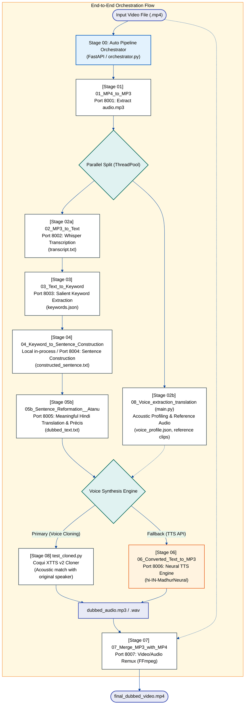
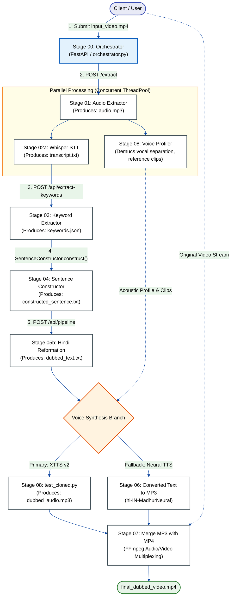

# Stage 00: Automated Pipeline Architecture (00_Auto_Pip)

This document provides a comprehensive overview of the **Nativox Stage 00 Automated Pipeline Orchestrator** (`00_Auto_Pip`), detailing how it acts as the central coordinator across all underlying microservices to perform end-to-end video dubbing.

---

## 1. High-Level Architecture Overview

Stage 00 provides a unified HTTP and CLI entrypoint (`http://127.0.0.1:8000` or `orchestrator.py`). When an MP4 video is submitted, the orchestrator handles process management, parallel extraction, translation, synthesis, and remuxing.



---

## 2. Microservice Ports and Responsibilities

The orchestrator communicates with sub-services via HTTP REST calls or dedicated sub-process invocations:

| Stage ID | Directory Name | Protocol / Port | Role & Primary Artifacts |
| :--- | :--- | :--- | :--- |
| **Stage 00** | `00_Auto_Pip` | HTTP `8000` / CLI | Master orchestrator, web UI, job status, process management. |
| **Stage 01** | `01_MP4_to_MP3` | HTTP `8001` (`/extract`) | Demuxes input video into standard `audio.mp3`. |
| **Stage 02a** | `02_MP3_to_Text` | HTTP `8002` (`/api/transcribe`) | Automatic transcription and source language detection via Whisper. |
| **Stage 02b** | `08_Voice_extraction_translation` | In-process sub-process (`main.py`) | Extracts vocal energy, background track, pitch profile, and clean speaker reference clips. |
| **Stage 03** | `03_Text_to_Keyword` | HTTP `8003` (`/api/extract-keywords`) | Extracts salient keywords from the transcription text. |
| **Stage 04** | `04_Keyword_to_Sentence_Construction` | Python direct import (`construct.py`) | Synthesizes well-formed grammatical sentences from keywords using saved model weights. |
| **Stage 05b** | `05b_Sentence_Reformation__Atanu` | HTTP `8005` (`/api/pipeline`) | Restructures and produces meaningful, concise Hindi translation (`dubbed_text.txt`). |
| **Stage 06 (Clone)** | `08_Voice_extraction_translation` | In-process sub-process (`test_cloned.py`) | XTTS v2 zero-shot voice cloning matching timbre and pitch to the original speaker. |
| **Stage 06 (Fallback)** | `06_Converted_Text_to_MP3` | HTTP `8006` (`/api/synthesize`) | Fallback neural speech synthesis (e.g., `hi-IN-MadhurNeural`). |
| **Stage 07** | `07_Merge_MP3_with_MP4` | HTTP `8007` (`/api/merge`) | FFmpeg remuxing that synchronizes and combines dubbed audio back with original video. |

---

## 3. Detailed Step-by-Step Sequence



### Detailed Sequence Call Breakdown

| Step | Caller | Target Service / Component | Payload / Input | Returned Output Artifact |
| :---: | :--- | :--- | :--- | :--- |
| **1** | Client | **Stage 00 (Orchestrator)** | `input_video.mp4` | Job initialized (`jobs/job_<id>/`) |
| **2** | Stage 00 | **Stage 01 (Audio Extractor)** | `POST /extract` (video) | `audio.mp3` |
| **3a** | Stage 00 | **Stage 02a (Whisper STT)** | `POST /api/transcribe` (`audio.mp3`) | `transcript.txt` + `detected_language` |
| **3b** | Stage 00 | **Stage 08 (`main.py`)** | Run in-process on `audio.mp3` | `voice_profile.json`, `voice_profile_clips/`, `voice_profile_background.wav` |
| **4** | Stage 00 | **Stage 03 (Keyword Extraction)** | `POST /api/extract-keywords` (`transcript.txt`) | `keywords.json` |
| **5** | Stage 00 | **Stage 04 (Sentence Constructor)** | `construct(keywords)` in-process | `constructed_sentence.txt` |
| **6** | Stage 00 | **Stage 05b (Hindi Reformation)** | `POST /api/pipeline` (`constructed_sentence.txt`) | `dubbed_text.txt` (meaningful Hindi) |
| **7** | Stage 00 | **Stage 08 (`test_cloned.py`)** | Cloner (`dubbed_text.txt` + acoustic profile + clips) | `dubbed_audio.mp3` (with background preserved) |
| *7 (alt)* | Stage 00 | **Stage 06 (`text_to_mp3`)** | Fallback `POST /api/synthesize` (MadhurNeural) | `dubbed_audio.mp3` |
| **8** | Stage 00 | **Stage 07 (Video Merge)** | `POST /api/merge` (`input_video.mp4` + `dubbed_audio.mp3`) | `final_dubbed_video.mp4` |

---

## 4. Job Workspace Directory Structure

For every execution run, a dedicated job workspace directory is instantiated inside `Dubbing/00_Auto_Pip/jobs/<job_id>/`:

```text
jobs/job_<id>/
├── input_video.mp4             # Original source video
├── audio.mp3                   # Extracted original audio (Stage 01)
├── transcript.txt              # Whisper transcription text (Stage 02a)
├── voice_profile.json          # Speaker pitch, energy, EQ metrics (Stage 02b)
├── voice_profile_reference.wav # Clean reference vocal audio clip (Stage 02b)
├── voice_profile_clips/        # Segmented speaker reference clips (Stage 02b)
├── voice_profile_background.wav# Separated ambient/background track (Stage 02b)
├── keywords.json               # Extracted salient keywords (Stage 03)
├── constructed_sentence.txt    # Grammatically structured sentence (Stage 04)
├── reformed_text.json          # Translation & précis intermediate results (Stage 05b)
├── dubbed_text.txt             # Final translated Hindi text to speak (Stage 05b)
├── dubbed_audio.wav            # Cloned Hindi speech waveform (Stage 08 / 06)
├── dubbed_audio.mp3            # Cloned speech mixed with background (Stage 08 / 06)
└── final_dubbed_video.mp4      # Final synchronized dubbed video (Stage 07)
```
