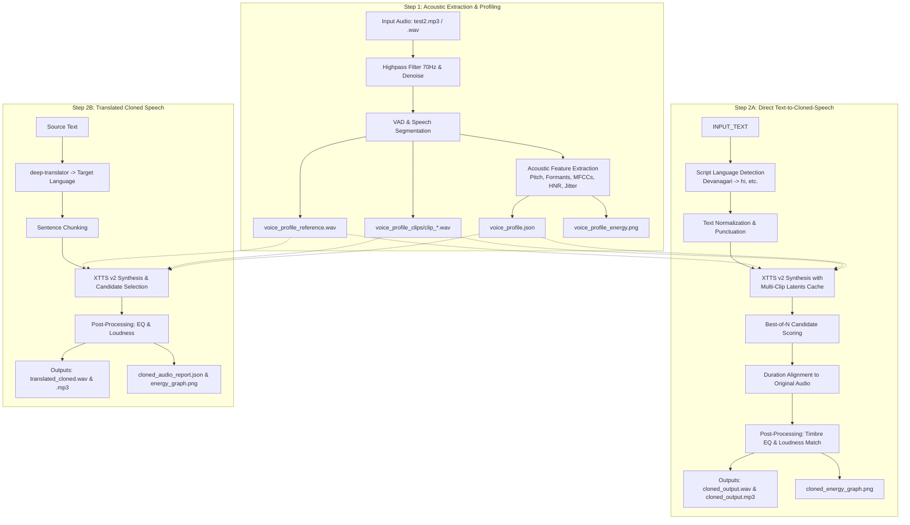

# 🎙️ Stage 08 — Acoustic Voice Extraction, Profiling & Cloned Translation

> **Part of the [Nativox Dubbing Suite](../README.md)**  
> *Stage 08 extracts an author's complete vocal fingerprint from source dialogue and synthesizes high-fidelity, natural cloned speech in any supported language with automatic duration alignment and acoustic matching.*

---

## 📌 Table of Contents
1. [Overview](#-overview)
2. [Key Features](#-key-features)
3. [Architecture & Workflow](#-architecture--workflow)
4. [File & Directory Structure](#-file--directory-structure)
5. [Installation & Setup](#-installation--setup)
6. [Detailed Script Guide](#-detailed-script-guide)
   - [1. `main.py` — Voice Profiler & Clip Extractor](#1-mainpy--voice-profiler--clip-extractor)
   - [2. `test_cloned.py` — Direct Text-to-Cloned-Voice Synthesis](#2-test_clonedpy--direct-text-to-cloned-voice-synthesis)
   - [3. `test_translate.py` — Translated Cloned Speech](#3-test_translatepy--translated-cloned-speech)
7. [Settings & Configuration Reference](#-settings--configuration-reference)
8. [Supported Languages](#-supported-languages)
9. [Audio Quality & Anti-Robotic Tuning](#-audio-quality--anti-robotic-tuning)
10. [Troubleshooting & FAQs](#-troubleshooting--faqs)

---

## 🔍 Overview

When dubbing or replacing dialogue in video content, standard text-to-speech engines produce synthetic, generic voices that break immersion. **Stage 08** solves this by:
1. **Extracting a comprehensive vocal fingerprint** from a speaker's audio clip (pitch dynamics, vocal tract formants, jitter, shimmer, harmonics-to-noise ratio, spectral envelope, speaking cadence, and emotional tone).
2. **Generating clean reference material** tailored for deep learning cloning architectures (Coqui XTTS v2).
3. **Cloning the author's voice without robotic artifacts**, speaking either directly supplied text (`test_cloned.py`) or translated script (`test_translate.py`).
4. **Matching the exact duration of the original audio** so dubbed speech fits the video scene without drifting out of sync.
5. **Auto-detecting language from text scripts** to prevent "Hinglish" or mixed-phoneme pronunciation errors.

---

## ✨ Key Features

- **🔬 Comprehensive Acoustic Profiling:**
  - **Pitch ($F_0$) Dynamics:** pYIN fundamental frequency tracking, median/mean, semitone intonation range, standard deviation, and contour analysis.
  - **Vocal Tract Formants ($F_1$–$F_4$):** Praat/Parselmouth tracking of vocal tract resonant frequencies, dispersion, and formants bandwidth.
  - **Voice Quality:** Local jitter (pitch perturbation), local shimmer (amplitude perturbation), and Harmonics-to-Noise Ratio (HNR).
  - **Timbre & Spectral Envelope:** Spectral centroid, bandwidth, rolloff, flatness, zero-crossing rate, and 20 MFCCs (means + standard deviations).
  - **Rhythm & Cadence:** Syllables per second, speaking tempo, and active pause-to-speech ratio.
- **🎯 Multi-Clip Latent Conditioning:**
  - Instead of relying on a single noisy audio file, `main.py` automatically isolates multiple high-energy, silence-free 6–12 second reference clips (`voice_profile_clips/`).
  - XTTS extracts speaker embeddings across all clips simultaneously, producing richer, more faithful speaker identities. Latents are cached in `voice_latents.pt` for fast re-runs.
- **⏱️ Automatic Duration Matching:**
  - Matches the output speech length to the original source duration (e.g., an 8-second input yields an 8-second clone), preventing video desynchronization.
- **🌐 Script-Aware Language Detection:**
  - Detects native writing scripts (Devanagari, Arabic, CJK, Cyrillic, Latin) via Unicode range analysis. Prevents phoneme mismatch where Hindi written in Devanagari is mistakenly synthesized with English phonetic rules.
- **🏆 Multi-Candidate Take Selection:**
  - Synthesizes multiple takes per sentence chunk with varying random seeds and scores each candidate against the original speaker's MFCC timbre and pitch metrics to pick the best take.
- **🎛️ Gentle Post-Processing:**
  - Smooth STFT long-term spectral equalization (limited to $\pm 3\text{ dB}$) matching the original voice warmth.
  - Active-speech loudness matching (dB RMS) and soft-peak limiting.
- **📊 Diagnostic Reporting:**
  - Generates visual energy and pitch comparison graphs (`cloned_energy_graph.png`, `voice_profile_energy.png`) and quantitative similarity reports (`cloned_audio_report.json`).

---

## 🏗️ Architecture & Workflow



---

## 📁 File & Directory Structure

```text
Dubbing/08_Voice_extraction_translation/
├── main.py                      # Step 1: Extracts vocal features, builds reference WAV & clips
├── test_cloned.py               # Step 2A: Direct text-to-cloned speech (duration & script matched)
├── test_translate.py            # Step 2B: Translates text and synthesizes in cloned voice
├── test2.mp3                    # Sample input audio file
├── .output/                     # Dedicated hidden output directory (auto-created via attrib +h)
│   ├── voice_profile.json       # Comprehensive JSON profile with all acoustic metrics
│   ├── voice_profile_reference.wav # Normalized, silence-free ~30s reference audio (22,050 Hz)
│   ├── voice_profile_clips/     # Clean 6-12s speech clips for conditioning (clip_01.wav, etc.)
│   ├── voice_profile_background.wav # Preserved original background stem (Demucs htdemucs)
│   ├── voice_profile_vocals.wav # Isolated clean vocal stem
│   ├── voice_profile_energy.png # Energy and pitch track visualization of source voice
│   └── voice_latents.pt         # Cached XTTS speaker & GPT conditioning tensors
└── README.md                    # Module documentation
```

---

## ⚙️ Installation & Setup

### 1. Prerequisites
- **Python:** 3.9, 3.10, or 3.11
- **FFmpeg:** Installed on your system and added to your system `PATH` (required for MP3 export via `pydub`).
- **NVIDIA GPU (Recommended):** CUDA 11.8 or 12.1 for fast XTTS inference. CPU inference works as a fallback.

### 2. Python Packages Installation
Run the following in your terminal:

```bash
# Core audio processing & scientific computing
pip install numpy librosa soundfile scipy matplotlib pydub

# Deep learning framework (install CUDA-enabled version if GPU available)
pip install torch torchaudio

# Voice cloning engine
pip install coqui-tts

# Acoustic profiling & vocal tract analysis
pip install praat-parselmouth noisereduce

# Language detection, text translation & number expansion
pip install deep-translator langdetect num2words

# (Optional) Speaker embedding & deep emotion models
pip install resemblyzer transformers
```

> [!NOTE]
> **Windows Torchaudio Note:** On Windows with TorchAudio 2.9+, importing `torchaudio` can trigger errors looking for FFmpeg C DLLs (`torchcodec`). Both `test_cloned.py` and `test_translate.py` include an embedded patch (`_patch_torchaudio_io()`) that routes audio I/O through `soundfile`, preventing crashes.

---

## 📖 Detailed Script Guide

### 1. `main.py` — Voice Profiler & Clip Extractor

Analyzes an input dialogue audio file and extracts its acoustic characteristics.

#### Execution
```bash
python main.py
```
*(Optionally change `AUDIO_PATH` at the top of `main.py` to target your file)*

#### What It Does:
1. **Audio Cleansing:** Runs a 4th-order Butterworth high-pass filter at 70 Hz to remove DC offset and low-end microphone rumble. Optionally runs non-stationary noise reduction (`noisereduce`).
2. **Active Speech Segmentation:** Computes RMS energy across 2048-sample frames, identifying voiced segments and removing dead silences.
3. **Reference Generation:**
   - Produces `voice_profile_reference.wav` (up to 30 seconds of pure active speech).
   - Segments speech into multiple 6–12 second clips in `voice_profile_clips/`.
4. **Feature Extraction:**
   - **Pitch:** Fundamental frequency ($F_0$) via `librosa.pyin` (65 Hz – 500 Hz search range). Computes mean, median, standard deviation, musical note (`f0_mean_note`), semitone range, and intonation variability.
   - **Formants & Quality:** Uses `praat-parselmouth` (Burg algorithm) to extract $F_1, F_2, F_3, F_4$ resonance frequencies, formant dispersion, local jitter, local shimmer, and Harmonics-to-Noise Ratio (HNR).
   - **Timbre:** Extracts spectral centroid, bandwidth, rolloff (85%), spectral flatness, zero-crossing rate, and 20 MFCCs with delta and delta-delta coefficients.
   - **Rhythm:** Syllables per second, speaking pace, and speech-to-pause ratio.
   - **Emotion & Tone:** Analyzes acoustic valence/arousal heuristics.
5. **Output:** Saves `voice_profile.json` and renders `voice_profile_energy.png`.

---

### 2. `test_cloned.py` — Direct Text-to-Cloned-Voice Synthesis

Synthesizes arbitrary text directly into the cloned author's voice without translating. Built specifically for cases where the desired target script is already provided.

#### Execution
```bash
python test_cloned.py
```

#### What It Does:
1. **Language & Script Auto-Detection:**
   - Checks Unicode codepoints of the input text:
     - `0x0900`–`0x097F` $\rightarrow$ Hindi (`hi`, Devanagari)
     - `0x0600`–`0x06FF` $\rightarrow$ Arabic (`ar`)
     - `0x3040`–`0x30FF` $\rightarrow$ Japanese (`ja`)
     - `0xAC00`–`0xD7AF` $\rightarrow$ Korean (`ko`)
     - `0x4E00`–`0x9FFF` $\rightarrow$ Chinese (`zh-cn`)
     - `0x0400`–`0x04FF` $\rightarrow$ Russian (`ru`)
     - Latin alphabet $\rightarrow$ `langdetect` fallback
   - Warns if English/Latin words are mixed into non-Latin text (e.g., Hindi written with English loanwords) to prevent accent contamination.
2. **Text Normalization:**
   - Expands digits to spoken words in the target language via `num2words`.
   - Cleans quotes, ellipses, dashes, and normalizes whitespaces.
   - Ensures proper sentence-ending punctuation (`.` or `।` or `。`) to prevent XTTS from trailing off with hallucinated noises.
3. **Multi-Clip Latent Caching:**
   - Scans `voice_profile_clips/*.wav`.
   - Generates 30-second conditioning latents and caches them in `voice_latents.pt`. Subsequent runs load instantaneously.
4. **Multi-Candidate Synthesis:**
   - Chunks text at sentence boundaries.
   - Generates `N_CANDIDATES` takes per sentence chunk with different seeds.
   - Scores candidates against original reference MFCC timbre distance and $F_0$ median/std. The highest-fidelity candidate is selected.
5. **Duration Alignment:**
   - Reads the original audio duration from `voice_profile.json` (`metadata.duration_sec`).
   - If the generated speech duration deviates by more than `DURATION_TOLERANCE` (10%), it computes the required speed adjustment factor and re-synthesizes within safe natural speech rate bounds (`0.85x` – `1.30x`).
6. **Timbre EQ & Loudness Matching:**
   - Applies smooth spectral equalization (STFT filter, max $\pm 3\text{ dB}$) to match the long-term frequency curve of the reference voice.
   - Adjusts active speech RMS loudness to match the source author's loudness in dB.
7. **Outputs:**
   - `cloned_output.wav` and `cloned_output.mp3`.
   - `cloned_energy_graph.png`: 4-panel graph comparing original vs cloned energy contours, normalized time overlay, and $F_0$ pitch track.

---

### 3. `test_translate.py` — Translated Cloned Speech

Translates text from a source language to a target language and speaks the translation in the author's voice.

#### Execution
```bash
python test_translate.py
```

#### What It Does:
1. **Translation:** Uses `deep-translator` (Google Translator API) with automatic sentence boundary chunking.
2. **Synthesis:** Passes translated text to XTTS v2 with conditioning latents.
3. **Post-Processing:** Applies spectral EQ and loudness matching.
4. **Validation Report:** Analyzes the output and generates `cloned_audio_report.json`, detailing:
   - Pitch difference ($\Delta F_0$ in semitones)
   - Loudness difference ($\Delta \text{dB}$)
   - Spectral centroid shift ($\text{Hz}$)
   - Intonation standard deviation comparison

---

## 🎛️ Settings & Configuration Reference

### Configuration in `test_cloned.py`

| Setting | Default | Description |
| :--- | :--- | :--- |
| `INPUT_TEXT` | `""` | The text you want the cloned voice to speak. |
| `LANGUAGE` | `"auto"` | `"auto"` detects script automatically. Can be explicitly set to `hi`, `en`, `es`, `fr`, etc. |
| `MATCH_ORIGINAL_DURATION` | `True` | Automatically matches output duration to the original input recording length. |
| `TARGET_DURATION_SEC` | `None` | Set a float (e.g. `8.0`) to force an exact output duration; `None` uses profile length. |
| `DURATION_TOLERANCE` | `0.10` | Acceptable duration variance ($\pm 10\%$) before re-synthesizing with adjusted speed. |
| `MIN_SPEED` / `MAX_SPEED` | `0.85` / `1.30` | Speed boundary limits to prevent unnatural speech artifacts. |
| `N_CANDIDATES` | `2` | Takes generated per sentence chunk. The candidate closest to the original voice is selected. |
| `TEMPERATURE` | `0.65` | Expressiveness knob (`0.60`–`0.75`). Lower is more stable/consistent; higher is more expressive. |
| `REPETITION_PENALTY` | `5.0` | Prevents looped syllables or stuttering. |
| `MATCH_TIMBRE_EQ` | `True` | Applies gentle STFT spectral curve matching to the original voice. |
| `EQ_MAX_DB` | `3.0` | Maximum allowable EQ boost/cut (dB). Keeps filtering natural. |
| `MATCH_LOUDNESS` | `True` | Matches average active speech volume (dB RMS) to the original profile. |
| `OUTPUT_WAV` / `OUTPUT_MP3` | `"cloned_output.wav"` | Output file paths. |

### Configuration in `main.py`

| Setting | Default | Description |
| :--- | :--- | :--- |
| `AUDIO_PATH` | `"test2.mp3"` | Path to the source speaker audio file (WAV or MP3). |
| `USE_DENOISE` | `True` | Removes stationary background noise using `noisereduce`. |
| `REF_MAX_SEC` | `30` | Target maximum duration for `voice_profile_reference.wav`. |
| `MAX_REF_CLIPS` | `6` | Maximum number of clean speech clips saved to `voice_profile_clips/`. |
| `CLIP_TARGET_SEC` | `9` | Target length for each individual reference clip (6–12 seconds recommended). |

---

## 🌍 Supported Languages

Coqui XTTS v2 supports the following **17 languages**:

| Code | Language | Script | Code | Language | Script |
| :---: | :---: | :---: | :---: | :---: | :---: |
| `en` | English | Latin | `hi` | Hindi | Devanagari |
| `es` | Spanish | Latin | `ar` | Arabic | Arabic |
| `fr` | French | Latin | `zh-cn` | Chinese (Simplified) | Simplified Han |
| `de` | German | Latin | `ja` | Japanese | Kanji / Kana |
| `it` | Italian | Latin | `ko` | Korean | Hangul |
| `pt` | Portuguese | Latin | `ru` | Russian | Cyrillic |
| `pl` | Polish | Latin | `tr` | Turkish | Latin |
| `nl` | Dutch | Latin | `cs` | Czech | Latin |
| `hu` | Hungarian | Latin | | | |

> [!WARNING]
> **Unsupported Indic Languages:** XTTS v2 **does not** natively support Bengali (`bn`), Tamil (`ta`), Telugu (`te`), or other non-Hindi Indic scripts. Attempting to feed these scripts will be rejected by `test_cloned.py`.

---

## 💎 Audio Quality & Anti-Robotic Tuning

To ensure cloned voices sound natural, warm, and human rather than robotic or synthetic, the following design principles are implemented:

1. **No Phase-Vocoder Pitch Shifting:**
   - Traditional pitch-shifting algorithms (like `librosa.effects.pitch_shift`) introduce metallic phase artifacts and robotic flanging on speech.
   - XTTS v2 naturally learns and synthesizes at the reference speaker's fundamental frequency. Post-synthesis pitch shifting is disabled by default (`MATCH_PITCH = False`).
2. **Soft Timbre EQ (Band-Limited):**
   - Spectral correction is restricted to human vocal formants ($80\text{ Hz}$ to $7500\text{ Hz}$) and capped at $\pm 3\text{ dB}$ with Gaussian smoothing (`uniform_filter1d`), avoiding resonant ringing or harshness.
3. **Optimal Sampling Rates:**
   - Profiling and feature extraction operate at $22,050\text{ Hz}$ (standard Praat/librosa voice rate).
   - Synthesis runs natively at $24,000\text{ Hz}$ (XTTS v2 native rate).
4. **Multi-Clip Conditioning:**
   - Conditioning the model on multiple $6\text{--}12\text{ s}$ clips captures vocal variations across different phonetic contexts, leading to more lifelike intonation.
5. **Punctuation Padding:**
   - Every text chunk is enforced with terminal punctuation (`.` or `।`), preventing the model from generating breathy trailing phonemes or static at sentence ends.

---

## ❓ Troubleshooting & FAQs

### Q1: The output voice sounds like "Hinglish" or a mixture of accents.
**Cause:** This happens when Hindi text (or another non-Latin language) contains English words, or when the language parameter is set to `"en"` while feeding Devanagari script.  
**Fix:**
- Leave `LANGUAGE = "auto"` in `test_cloned.py`. The script will detect the Devanagari script and set the language code to `hi`.
- Transliterate English words into native script (e.g., write `कंप्यूटर` instead of `computer`).

### Q2: The output duration is longer or shorter than the original audio.
**Cause:** Different languages have different syllable densities. Translating from English to Hindi often expands syllable count by 15%–30%.  
**Fix:**
- Keep `MATCH_ORIGINAL_DURATION = True` in `test_cloned.py`. The script automatically calculates the duration difference and re-synthesizes at an adjusted speech rate (e.g. `x1.15`).
- If the text is substantially longer, shorten the text wording or adjust `MAX_SPEED` from `1.30` to `1.40`.

### Q3: `EPERM` or `FileNotFoundError` for FFmpeg when exporting MP3.
**Cause:** `pydub` requires `ffmpeg.exe` to encode MP3 files.  
**Fix:**
- Install FFmpeg on Windows via `winget install Gyan.FFmpeg` or download it from [gyan.dev](https://www.gyan.dev/ffmpeg/builds/) and add its `bin` folder to your Windows system `PATH`.
- Note: Even if MP3 export fails, `cloned_output.wav` is always saved successfully.

### Q4: First execution is slow.
**Cause:**
- First run downloads the XTTS v2 model weights (~2 GB).
- Computing speaker conditioning latents from reference clips takes a few seconds on the first run.  
**Fix:** The calculated latents are saved to `voice_latents.pt`. Subsequent runs load the cache instantly.

---

## ⚖️ Ethics & Responsible AI Use
Voice cloning technology must only be used on voices you own or have received explicit, verifiable permission to replicate. Always disclose synthetic media as AI-generated in downstream applications or public releases.
