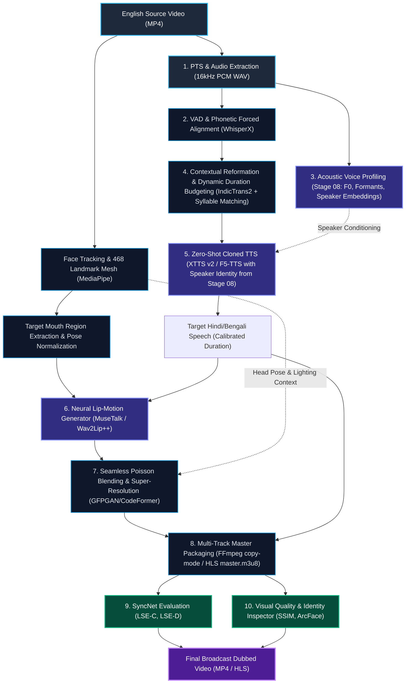

<!-- markdownlint-disable -->

# 🗺️ Nativox Future Roadmap: Present vs. Future Architecture & Evolution Plan

> **Multilingual Performance Transfer (English $\to$ Hindi & Bengali), Faculty Directives, Acoustic Profiling, and Neural Lip-Sync Generation.**

  
  
  
  

---

## 🎯 Executive Mission & Core Product Principles

### 1. Vision & Goal
Build a **speaker-independent, photorealistic AI video-dubbing system**. At inference time, the user supplies **one English source video** and selects either **Hindi** or **Bengali** as the target language. The pipeline produces a natural target-language video in which the original speaker appears to have natively performed the target-language dialogue.

### 2. Core Pillars
1. **Natural Indic Speech & Articulation:** Native pronunciation, fluent prosody, and language-specific mouth articulation conditioned directly on target-language audio.
2. **Audiovisual Synchronization:** Accurate timing across complete speaking intervals with verifiable lip-sync alignment ($LSE\text{-}D < 6.8$, $LSE\text{-}C > 6.0$).
3. **Identity & Expression Preservation:** Plausible lips, teeth, tongue, and jaw without deformation, blur, pasted-mouth appearance, flicker, or identity drift.
4. **Speaker Voice Identity Cloning:** The target speech sounds like the *original speaker speaking Hindi/Bengali*, not a generic stock narrator.
5. **Scene & Visual Continuity:** Zero head-pose discontinuities, preserved emotional expression, and seamless background blending.

---

## 📊 Comprehensive Comparison: Present State vs. Future Architecture

The table below contrasts our current implementation across all modules with the target production architecture planned in this roadmap:

| Pipeline Domain | Present Implementation (v1.0 Baseline) | Future Implementation (Target v2.0 Architecture) | Gap / Engineering Target |
| :--- | :--- | :--- | :--- |
| **Pipeline Automation & Orchestration** (`00_Auto_Pip`) | Sequential REST-polling orchestrator across discrete FastAPI ports (`8001`–`8007`). Intermediate outputs written to filesystem JSON/text files (`jobs/job1/`). | Event-driven async DAG orchestrator (Celery/Temporal or async worker queue) with in-memory streaming / Redis state caching, job queues, and real-time progress websockets. | Eliminates file I/O latency between stages, enables parallel batch processing and multi-user queueing. |
| **Audio Extraction & Ingestion** (`01_MP4_to_MP3`) | Static FFmpeg audio demuxing to MP3 at standard sample rate. Ignores PTS timestamps and audio-video drift offsets. | Lossless PCM/WAV extraction ($16\text{ kHz} / 48\text{ kHz}$) extracting Presentation Timestamps (PTS) for per-frame audiovisual packet alignment. | Prevents gradual macro-drift across long videos ($> 60\text{ seconds}$). |
| **Speech Recognition & Alignment** (`02_MP3_to_Text`) | Faster-Whisper base model generating text transcript and coarse segment-level start/end timestamps. | WhisperX with phonetic forced alignment (wav2vec 2.0 / CTC alignment) generating word- and phoneme-level timestamps + Voice Activity Detection (VAD). | Provides exact syllable timing essential for phoneme-to-viseme lip-synchronization. |
| **Content Extraction & Condensation** (`03_Text_to_Keyword`) | YAKE statistical keyword extraction with static n-gram weighting. | Semantic NER (Named Entity Recognition) + KeyBERT / transformer embeddings, preserving vital semantic entities while scoring non-essential speech fillers. | Retains contextual nuances, proper nouns, and technical vocabulary without losing sentence intent. |
| **Grammar & Sentence Construction** (`04_Keyword_to_Sentence_Construction`) | Fine-tuned Google Flan-T5 base converting fragmented keyword lists into syntactically valid English sentences. | Context-aware LLM / Flan-T5 with multi-speaker dialogue context conditioning and stylistic tone matching. | Eliminates robotic sentence restructuring; respects conversational cadence. |
| **Target Translation & Reformation** (`05b_Sentence_Reformation__Atanu`) | IndicTrans2 translation paired with mathematical precis budgeting enforcing $35\%-40\%$ compression window ($\lfloor 0.35 W \rfloor \le W_{\text{precis}} \le \lceil 0.40 W \rceil$). | Dynamic acoustic duration budgeting where target word counts are budgeted based on source audio *speaking duration ($t_{\text{speech}}$)* and Indic phoneme rate, rather than static word counts alone. | Completely eliminates acoustic overflow where translated Indic syllables run longer than source visual speech windows. |
| **Target Speech Synthesis (TTS)** (`06_Converted_Text_to_MP3`) | Microsoft Edge Neural TTS (`hi-IN-SwaraNeural`, `hi-IN-MadhurNeural`, `bn-IN-TanishaaNeural`) and gTTS fallback. Generic voice synthesis. | Zero-shot Voice Cloning (Coqui XTTS v2 / F5-TTS / CosyVoice) conditioned on the speaker's acoustic profile from Stage 08, matching original pitch, timbre, and emotion in Hindi/Bengali. | The video sounds like the *actual speaker* speaking native Hindi or Bengali. |
| **Acoustic Profiling & Extraction** (`08_Voice_extraction_translation`) | Standalone acoustic analyzer extracting pitch ($F_0$), Praat formants ($F_1-F_3$), jitter, shimmer, HNR, MFCCs, and reference WAV. | Integrated Neural Voice Profile Conditioning feeding speaker embedding vectors directly into Stage 06 TTS and duration-matching filters. | Connects Stage 08 directly into the automated pipeline (`00_Auto_Pip`) for automated zero-shot speaker cloning. |
| **Video Remuxing & Lip Synchronization** (`07_Merge_MP3_with_MP4`) | FFmpeg stream copy (`-c:v copy`) replacing original audio with synthesized MP3. Visual lips still speak English. | Neural Lip-Generation Subsystem (Wav2Lip++ / MuseTalk / VideoReTalking) modifying mouth and jaw movements to match target Indic phonemes, followed by color-matched blending and frame-rate preservation. | True visual dubbing: the speaker's lips naturally articulate Hindi and Bengali words. |
| **Multi-Language Delivery** | Single MP4 output with burnt-in single audio track. | Multi-track MP4 / HLS (`master.m3u8`) stream packaging with switchable English, Hindi, and Bengali audio tracks and synchronized subtitle streams. | Production-grade broadcast delivery for streaming platforms and educational portals. |
| **Quality & Sync Evaluation** | Manual perceptual review and subjective scoring. | Automated objective evaluation harness calculating SyncNet lip-sync confidence ($LSE\text{-}C$), lip-sync error distance ($LSE\text{-}D$), FID (Fréchet Inception Distance), and face identity similarity (FaceNet/ArcFace cosine distance). | Quantitative, publication-grade verification of dubbing realism. |

---

## 🏗️ End-to-End Future System Architecture

---

## 🚀 Future Implementation: Phased Engineering Roadmap

### Phase 1: Zero-Shot Voice Identity Cloning Integration (Q1 2026)
* **Goal:** Merge Stage 08 acoustic voice profiling directly into the core dubbing pipeline (`00_Auto_Pip` $\to$ `06_Converted_Text_to_MP3`).
* **Technical Deliverables:**
  1. Extract a $10-15\text{ second}$ clean reference sample from source video speech segments automatically.
  2. Integrate an on-premise zero-shot cloning engine (Coqui XTTS v2 or F5-TTS) into Stage 06.
  3. Condition Hindi synthesis on the original speaker's pitch profile ($F_0$), formant distribution, and speaker embedding vector.
  4. Train or fine-tune an Indic XTTS/VITS checkpoint supporting Bengali phonetic pronunciation and natural cadence.

---

### Phase 2: Dynamic Syllable-Aware Duration Budgeting (Q2 2026)
* **Goal:** Guarantee $100\%$ temporal match between translated Indic audio and the original speaker's speaking intervals.
* **Technical Deliverables:**
  1. **Acoustic Duration Windowing:** Replace word-count budgeting with millisecond-exact duration targets derived from WhisperX start/end timestamps:
     $$\Delta t_i = t_{\text{end}, i} - t_{\text{start}, i}$$
  2. **Indic Syllable Density Compensation:** Calculate target language syllable count and dynamically scale speech rate within $[-10\%, +15\%]$:
     $$\text{Target Rate} = \frac{\text{Syllables}_{\text{Indic}}}{\Delta t_i}$$
  3. **Closed-Mouth Silence Injection:** Measure Mouth Aspect Ratio ($\text{MAR} < 0.12$) from MediaPipe facial mesh to insert natural room pauses during silent frames, preventing cumulative timeline drift.

---

### Phase 3: Neural Lip-Sync Generation Subsystem (Q2–Q3 2026)
* **Goal:** Morph the speaker's mouth, lips, and lower face to match target Hindi/Bengali speech without visual artifacts.
* **Technical Deliverables:**
  1. **Inference Pipeline:** Deploy MuseTalk / Wav2Lip++ neural face generator conditioned on latent audio embeddings (WavLM/HuBERT).
  2. **Facial Realism Enhancement:** Pass generated lower-face regions through CodeFormer / GFPGAN for crisp teeth, tongue, and lip-boundary resolution.
  3. **Seamless Compositing:** Implement Poisson blending and Laplacian pyramid blending along masked jawlines to eliminate discoloration, blur borders, and "pasted-mouth" effects.
  4. **Head Pose Stability:** Ensure zero jittering across frame boundaries ($\text{Pose SSIM} > 0.99$).

---

### Phase 4: Independent SyncNet & Visual Quality Benchmark (Q3 2026)
* **Goal:** Provide automated, reproducible quantitative validation for every dubbed video.
* **Technical Deliverables:**
  1. **SyncNet Verification:** Compute Lip Sync Error Distance ($LSE\text{-}D$) and Lip Sync Error Confidence ($LSE\text{-}C$). Target: $LSE\text{-}D \le 6.5$, $LSE\text{-}C \ge 6.2$.
  2. **Identity Verification:** Compare ArcFace cosine distance between source and dubbed face crops (similarity score $\ge 0.92$).
  3. **Temporal Smoothness:** Calculate optical flow variance across mouth landmarks to catch frame-to-frame flickering.

---

### Phase 5: Production Deployment & Multi-Track Audio Streaming (Q4 2026)
* **Goal:** Deliver an enterprise-grade web application with multi-track video streaming.
* **Technical Deliverables:**
  1. **HLS Streaming Engine:** Generate HTTP Live Streaming (`.m3u8`) playlists with selectable audio streams (`#EXT-X-MEDIA:TYPE=AUDIO,LANGUAGE="hin"`, `LANGUAGE="ben"`, `LANGUAGE="eng"`).
  2. **Cloud GPU Microservice:** Decouple neural lip-sync generation into an isolated Dockerized worker (NVIDIA Triton / FastAPI on CUDA).
  3. **Interactive Side-by-Side Review UI:** Web interface showing synchronized side-by-side comparison (English Source vs. Dubbed Target) with waveform overlays and SyncNet score badges.

---

## 📈 Quantitative Acceptance Targets

To achieve final project sign-off, the future system must meet the following metrics across unseen test speakers:

| Metric | Target Criterion | Evaluation Method |
| :--- | :--- | :--- |
| **SyncNet Error Distance ($LSE\text{-}D$)** | $\le 6.50$ | Unsupervised SyncNet offset evaluator |
| **SyncNet Confidence ($LSE\text{-}C$)** | $\ge 6.00$ | SyncNet feature correlation confidence |
| **Speaker Identity Similarity** | $\ge 0.90$ | ArcFace facial embedding cosine similarity |
| **Visual Texture Quality** | $\text{PSNR} \ge 31\text{ dB}$, $\text{SSIM} \ge 0.94$ | Upper-face and non-mouth background preservation |
| **Timeline Drift Offset** | $< 40\text{ ms}$ over 5 minutes | Audio-visual PTS timestamp delta |
| **Speech Naturalness (MOS)** | $\ge 4.2 / 5.0$ | Blind Mean Opinion Score on Indic speech & prosody |

---

## 👥 Authors & Academic Context

* **Student Contributors:** Atanu Saha, Babin Bid, Rohit Kr Adak, Sagnik Bachhar
* **Faculty Guide:** Mr. Debjit Ghosh (Department of Computer Science & Engineering)
* **Project Suite:** Nativox — Modular Real-Time AI Multilingual Dubbing & Neural Lip-Sync Suite

---

  <a href="README.md">🏠 Suite Overview</a> &bull; <a href="ARCHITECTURE.md">🏛️ Architecture</a> &bull; <a href="INSTRUCTIONS.md">📖 Instructions</a> &bull; <a href="ROADMAP.md">🗺️ Roadmap</a>

  <b>Nativox</b> &bull; Real-Time AI Multilingual Dubbing Suite &bull; <b>End of Roadmap Specification</b>

