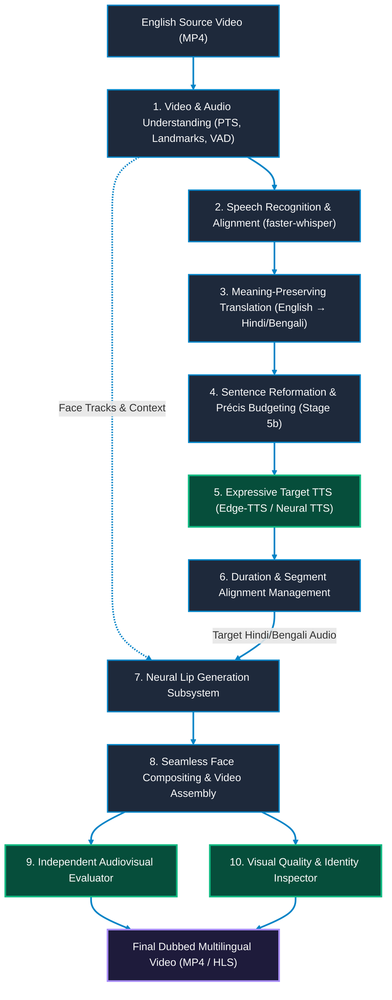

# Future Roadmap & Multilingual AI Video Dubbing Evolution

Multilingual Performance Transfer (English to Hindi/Bengali), Faculty Directives, and Architecture Evolution.

<!-- markdownlint-disable MD033 -->

  
  
  
  

<!-- markdownlint-enable MD033 -->

---

## 🎯 Executive Mission & Core Product Principles

### Mission
Build a **speaker-independent AI video-dubbing system**. At inference time, the user provides **one English source video** and selects **Hindi or Bengali** as the target language. The system produces a natural target-language video in which the original speaker appears to have naturally performed the target-language dialogue.

The output must deliver:
1. **Natural Hindi/Bengali Speech & Articulation:** Native pronunciation, fluent prosody, and language-specific mouth articulation conditioned directly on target-language audio.
2. **Audiovisual Synchronization:** Accurate timing across complete speaking intervals with measurable lip-sync alignment.
3. **Identity & Expression Preservation:** Plausible lips, teeth, tongue, and jaw without deformation, blur, pasted-mouth appearance, flicker, or identity drift.
4. **Scene & Visual Continuity:** Zero head-pose discontinuities, preserved emotional expression, and seamless background blending.

This is not merely audio replacement or a superficial lip-animation demo; it is **convincing multilingual performance transfer**.

### Core Engineering Principles
- **Generalize to Unseen Speakers:** Must generalize across genders, ethnicities, head poses, and accents; never overfit to pilot speakers.
- **Condition Articulation on Target Audio:** Target mouth motion is conditioned on synthesized Hindi/Bengali acoustics, not copied from English source frames.
- **Preserve Timestamps via PTS:** Strict adherence to Presentation Timestamps (PTS). Never assume constant frame rates or 1:1 frame count parity across languages.
- **Decoupled Evaluation from Generation:** Independent audiovisual sync and visual quality evaluation pipelines.
- **Hardware-Aware Execution:** Local workstation execution for decoding, feature extraction, and lightweight pipelines; NVIDIA Cloud GPU allocation for neural lip-generation/fine-tuning.
- **Reproducible & Verifiable:** Explicit versioning of checkpoints, configs, seeds, and datasets. Never fabricate metrics.

---

## 🏗️ End-to-End System Architecture

---

## 📑 Core Faculty Directives & Engineering Milestones

### Directive 1: Sentence Reformation (Contextual Restructuring) — [Completed: Stage 5(b)]
- **Status:** **Completed** in [`05b_Sentence_Reformation__Atanu/`](05b_Sentence_Reformation__Atanu/README.md)
- **Delivered Capabilities:**
  - Automatic filtering of conversational fillers (*um, uh, basically, you know*) and false speech starts.
  - Reconstructs English SVO (Subject-Verb-Object) into natural Indic SOV (Subject-Object-Verb) grammar.
  - Inserts Hindi/Bengali case markers, postpositions, and predicate conjugations.

---

### Directive 2: Syntax Learning & Ingestion Engine — [Completed: Stage 4]
- **Status:** **Completed** in [`04_Keyword_to_Sentence_Construction/`](04_Keyword_to_Sentence_Construction/README.md)
- **Delivered Capabilities:**
  - PDF/DOCX multi-document text extraction engine.
  - Self-supervised synthetic corruption engine (`SentenceCorrupter`) simulating fragmented speech.
  - Seq2Seq fine-tuning framework using Google Flan-T5 with multi-beam search decoding.

---

### Directive 3: Useful-to-Short Sentence Compression & Duration Budgeting — [Completed & Iterating]
- **Status:** **Core Engine Completed** in [`05b_Sentence_Reformation__Atanu/`](05b_Sentence_Reformation__Atanu/README.md)
- **Delivered Capabilities & Refinements:**
  - Enforces strict 35%–40% word budget window:
    $$\lfloor 0.35 \times W_{\text{orig}} \rfloor \le W_{\text{precis}} \le \lceil 0.40 \times W_{\text{orig}} \rceil$$
  - Eliminates acoustic overflow when translated Indic phonemes exceed the original visual speaking window.
  - Dynamic segment-aware duration matching preserving natural silence and pauses.

---

### Directive 4: Expressive Multilingual TTS Synthesis — [Completed: Stage 6 / Expanding]
- **Status:** **Completed for Hindi** in [`06_Converted_Text_to_MP3/`](06_Converted_Text_to_MP3/README.md); **Bengali Support Expanding**
- **Delivered Capabilities:**
  - Microsoft Edge Neural TTS integration (`hi-IN-SwaraNeural`, `hi-IN-MadhurNeural`, `bn-IN-TanishaaNeural`, `bn-IN-BashkarNeural`).
  - Adjustable prosody, pitch, and speech-rate scaling without API costs.
  - Expansion to voice cloning, pitch preservation, and emotion-conditioned prosody transfer.

---

### Directive 5: Lossless Video Remuxing & Multi-Track Audio Packaging — [Completed: Stage 7]
- **Status:** **Completed** in [`07_Merge_MP3_with_MP4/`](07_Merge_MP3_with_MP4/README.md)
- **Delivered Capabilities:**
  - FFmpeg copy-mode remux (`-c:v copy`) for byte-level visual preservation.
  - AAC audio transcoding (`-c:a aac -b:a 192k`) with `-movflags +faststart` for web streaming.
  - Foundation for HLS/DASH multi-track audio delivery (`master.m3u8`) with decoupled language selection.

---

## 🔬 Advanced Research Roadmap & Subsystem Specifications

The research subsystem focuses on deep audiovisual synchronization, neural mouth motion generation, and rigorous quantitative evaluation.

### Phase 1: Reference Set Analysis & Multi-Language Calibration (Active)
- **Controlled Tri-lingual Reference Set:** Inspect `tests/Eng_Test_1.mp4`, `tests/Hin_Test_1.mp4`, and `tests/Ben_Test_1.mp4` featuring the same speaker across all 3 languages.
- **Per-Frame & PTS Auditing:**
  - Extract exact presentation timestamps (PTS) for all decoded video frames and audio packets.
  - Track MediaPipe face mesh, 468 landmarks, mouth aspect ratio (MAR), and jaw dynamics.
  - Phoneme-level alignment via forced alignment to compare English vs. Hindi vs. Bengali viseme distributions.
  - **Constraint:** Reference videos are calibration/diagnostic sets, not full general-purpose training datasets. Never force identical duration or perform 1:1 frame-to-frame pixel comparisons across languages.

### Phase 2: Pipeline Synchronization & Timestamp Chaining (Active)
- **Segment-Wise Timestamp Chaining:** Read Faster-Whisper segment timestamps $(t_{\text{start}, i}, t_{\text{end}, i})$ to process sentence units independently, preventing whole-video information collapse.
- **Closed-Mouth Pause-Gated Silence Injection:** Detect closed-mouth intervals ($\text{MAR} < 0.12$) to anchor audio pacing and insert natural ambient silences without cumulative drift.
- **Dynamic Syllable Compensation:** Calculate Indic syllable density and dynamically adapt TTS playback rate within $[-15\%, +25\%]$ to match visual opening windows.

### Phase 3: Neural Lip-Generation Subsystem
- **Target-Audio Conditioned Generation:** Condition mouth and jaw dynamics on synthesized target-language (Hindi/Bengali) audio features (Mel-spectrograms / HuBERT / WavLM features).
- **Architecture Exploration:** Benchmark state-of-the-art models (Wav2Lip, VideoReTalking, MuseTalk) behind an isolated adapter/service interface.
- **Visual Artifact Mitigation:**
  - Seamless Poisson and multi-band blending to prevent pasted-mouth boundaries.
  - High-frequency texture and teeth detail restoration via super-resolution or discriminator losses.
  - Expression and head-pose invariance (background SSIM $> 0.99$).

### Phase 4: Independent Audiovisual & Quality Evaluation
- **Audiovisual Sync Metric:** Windowed SyncNet evaluation measuring lip-sync confidence ($LSE\text{-}C$) and minimum sync error offset ($LSE\text{-}D, \tau^*$).
- **Visual Quality Verification:** Automated detection of blur, flicker, temporal discontinuities, and facial identity drift.
- **Human Verification Loop:** Maintain manual review flags for ambiguous perceptual intervals; never mask localized anomalies within global average scores.

### Phase 5: Scalable Dataset Policy & Cloud GPU Training
- **Dataset Expansion:** Curate multi-speaker, licensed Hindi and Bengali audiovisual datasets with diverse head poses, lighting, and speaking rates.
- **Speaker-Disjoint Partitions:** Split datasets strictly by speaker identity to guarantee true out-of-sample generalization.
- **Hardware Isolation:** Workstation CPU/Iris Xe for lightweight preprocessing and testing; NVIDIA CUDA cloud instances for GPU-accelerated neural training and fine-tuning.

---

## 🧪 Pipeline A vs. Pipeline B Experiment Directives

To benchmark execution strategies reliably across English, Hindi, and Bengali:
- **Exclusion Constraint:** Both Pipeline A (`00_Auto_Pip`) and Pipeline B (Individual Stages 01 $\to$ 07) must strictly skip Stage 5(a) (`05a_Keyword_Translation__Sagnik`).
- **Pipeline A Configuration:** Preserve Stage 00 automated orchestrator; configure it to bypass Stage 5(a) cleanly without manual interventions.
- **Pipeline B Configuration:** Execute modular stages sequentially in verified dependency order, omitting Stage 5(a).
- **Comparison Protocol:** Run identical source videos under both pipelines; generate and evaluate Hindi and Bengali streams separately; verify Stage 5(a) is never triggered indirectly.

---

## 📅 Roadmap Execution Checklist & Acceptance Criteria

- [x] **Milestone 1: Acoustic Pipeline & Video Assembly** (Stages 01–07 integrated and functional for Hindi).
- [ ] **Milestone 2: Bengali Expansion** (Full Bengali neural TTS, phonetic dictionaries, and translation validation).
- [ ] **Milestone 3: Tri-Lingual Reference Benchmark** (Complete PTS and landmark audit across `Eng_Test_1`, `Hin_Test_1`, `Ben_Test_1`).
- [ ] **Milestone 4: Timestamp Chaining & Pause Injection** (Eliminate macro-drift and video length collapses).
- [ ] **Milestone 5: Pretrained Lip-Gen Baseline** (Deploy adapter-isolated Wav2Lip/MuseTalk baseline on cloud GPU).
- [ ] **Milestone 6: Indic Lip-Gen Fine-Tuning** (Train generator on consented Hindi/Bengali speech corpora with speaker-disjoint splits).
- [ ] **Milestone 7: Decoupled Multi-Track Delivery** (Dynamic HLS streaming with switchable English/Hindi/Bengali audio tracks).
- [ ] **Milestone 8: Generalization & Quality Sign-Off** (Validated on completely unseen speakers with $LSE\text{-}D < 6.8$, no visual artifacts, and verified sync).

---

## 👥 Authors & Academic Context

- **Student Contributors:** Atanu Saha, Babin Bid, Rohit Kr Adak, Sagnik Bachhar
- **Faculty Guide:** Mr. Debjit Ghosh (Department of Computer Science & Engineering)
- **Suite:** Nativox Modular Real-Time AI Multilingual Dubbing Suite

---

<!-- markdownlint-disable MD033 -->

  <a href="README.md">🏠 Suite Overview</a> &bull; <a href="ARCHITECTURE.md">🏛️ Architecture</a> &bull; <a href="INSTRUCTIONS.md">📖 Instructions</a> &bull; <a href="ROADMAP.md">🗺️ Roadmap</a>

  <b>Nativox</b> &bull; Real-Time AI Multilingual Dubbing Suite &bull; <b>End of Roadmap Specification</b>

<!-- markdownlint-enable MD033 -->
