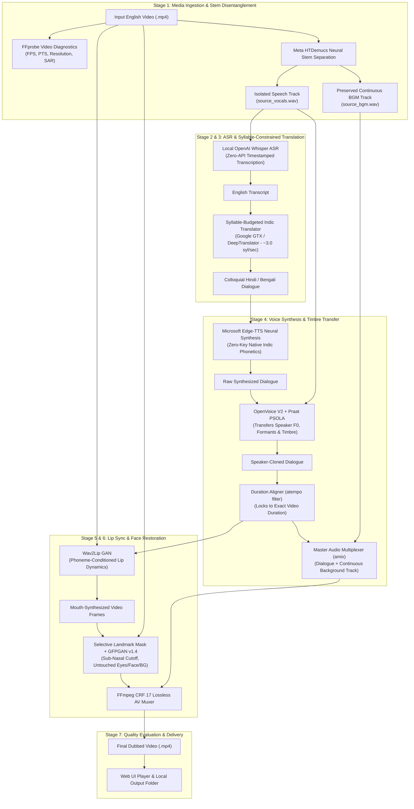
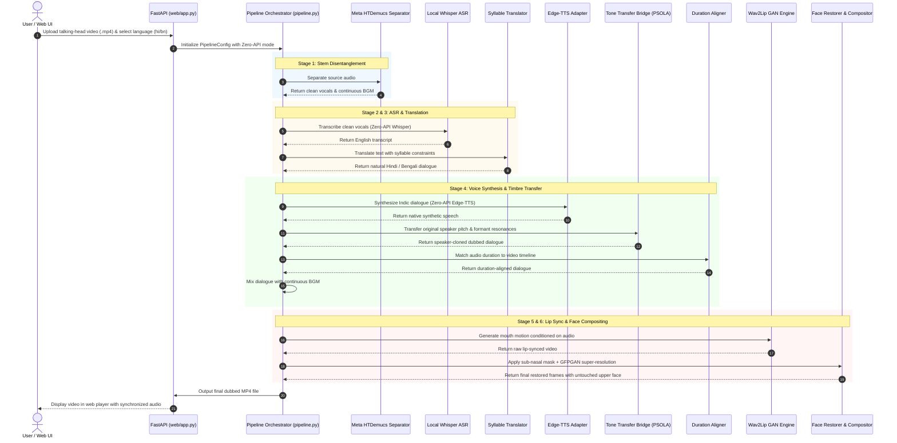
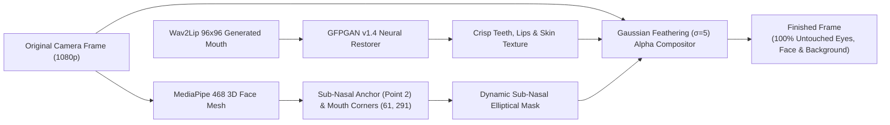

<!-- markdownlint-disable -->

# Nativox: System Architecture & Workflow Diagrams

> **Creator & Lead Architect**: Babin Bid  
> This document details the multi-stage architecture of the **Nativox Zero-API Multilingual Video Dubbing Pipeline** using comprehensive Mermaid flowcharts and sequence diagrams.

---

## 1. High-Level Pipeline Architecture

---

## 2. Complete Sequence Flow Diagram

---

## 3. Sub-Nasal Selective Compositing Topology

