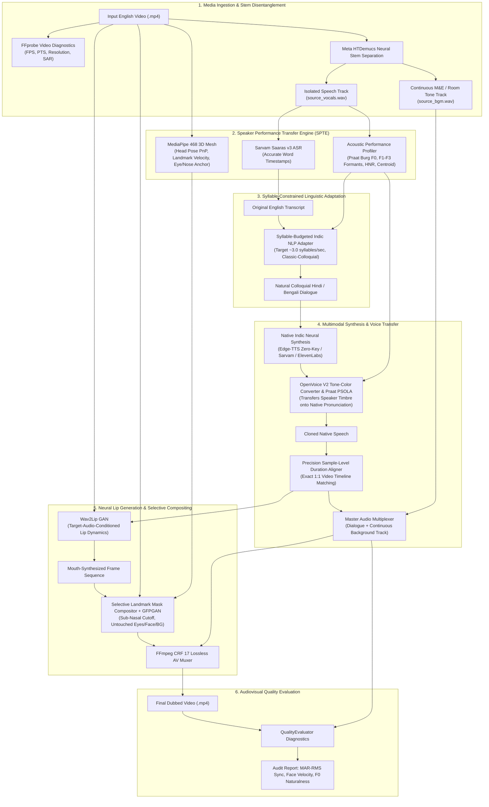
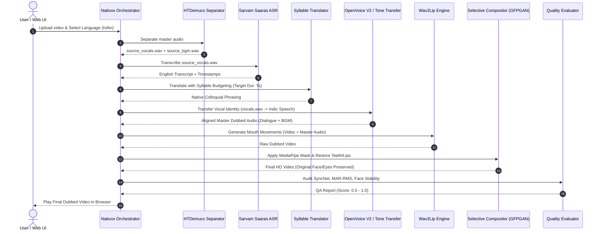

<!-- markdownlint-disable -->

# Nativox LipSync_Babin Pipeline: Performance-Preserving Multilingual Video Dubbing
## Comprehensive System Architecture & Engineering Documentation

> **Creator & Lead Architect**: Babin Bid  
> The **LipSync_Babin pipeline** is an autonomous, speaker-independent AI video dubbing pipeline that translates and dubs English talking-head videos into natural Hindi and Bengali. The central innovation is its **Speaker Performance Transfer Engine (SPTE)**: a system that extracts and transfers not just *what* the speaker said, but *how* the speaker delivered it—preserving vocal timbre, pitch dynamics, emotional inflection, facial landmarks, and continuous background music (BGM).

---

## 1. High-Level LipSync_Babin Pipeline Architectural Flow



---

## 2. Step-by-Step Tech Stack Breakdown

| Stage | Process | Technology & Framework | Purpose & Exact Role |
| :--- | :--- | :--- | :--- |
| **1** | **Video Diagnostics** | `FFmpeg` / `ffprobe` | Analyzes video codec, framerate, duration, resolution, and presentation timestamps (PTS). |
| **2** | **Neural Stem Separation** | `Meta HTDemucs` (`demucs.api`) | Disentangles dialogue from background music and sound effects. Produces pure dialogue for ASR and a continuous ambient/BGM track. |
| **3** | **Speech Recognition** | `OpenAI Whisper` (Local) / `Sarvam Saaras v3` | High-accuracy speech-to-text with word-level timestamps. Automatically uses local Whisper when API keys are not provided. |
| **4** | **Linguistic Adaptation** | `Google GTX / DeepTranslator` (Zero-Key) / `Sarvam 105B` | Colloquial spoken adaptation. Enforces strict syllable budgeting (~3 syllables/sec) to match original breath pacing. |
| **5** | **Neural Speech Synthesis** | `Microsoft Edge-TTS` (Zero-Key) / `Sarvam Bulbul` / `ElevenLabs` | Synthesizes speech with native phonetic articulation. Edge-TTS operates completely free with zero API keys. |
| **6** | **Speaker Voice Transfer** | `OpenVoice V2` + `Praat PSOLA` | Extracts speaker vocal tract profile ($F_0$, $F_1, F_2, F_3$ formants, HNR) and maps the timbre onto native Indic speech. |
| **7** | **Duration & Tempo Alignment**| `utils.duration_aligner` | Uses chained pitch-invariant `atempo` filters to align dubbed speech to the video duration to the millisecond. |
| **8** | **Audio Master Multiplexing** | `FFmpeg` / `amix` filter | Mixes the continuous background music track beneath the dubbed dialogue along the original timeline. |
| **9** | **Neural Lip Synchronization**| `Wav2Lip GAN` | Articulates mouth motion conditioned on target-language phonemes across every speaking frame. |
| **10**| **Selective Face Compositing**| `MediaPipe Face Mesh` (468 points) | Isolates the sub-nasal mouth region with temporal feathering. Leaves eyes, forehead, skin, and background 100% untouched. |
| **11**| **Facial Super-Resolution** | `GFPGAN v1.4` | Restores micro-textures (teeth boundaries, lip contours) to high definition. |
| **12**| **A/V Quality Diagnostics** | `QualityEvaluator` (`librosa`, `parselmouth`, `cv2`) | Measures MAR-RMS cross-correlation, landmark velocity stability, and voiced ratios. |
| **13**| **Web Dashboard** | `FastAPI`, `Uvicorn`, `Jinja2`, HTML5/CSS3 | Provides a web UI for drag-and-drop video uploads, live pipeline logging, and video playback. |

---

## 3. Sequence Flow Diagram



---

## 4. Environment Setup & Configuration

### Prerequisites
* Windows 10/11 or Linux
* Python 3.11
* FFmpeg on system `PATH`

### 1. Initialize Virtual Environment
```powershell
# Create virtual environment
py -3.11 -m venv .venv

# Activate virtual environment
.venv\Scripts\Activate.ps1

# Upgrade pip
python -m pip install --upgrade pip

# Install dependencies
pip install -r requirements.txt
pip install fastapi uvicorn python-multipart jinja2 requests
```

### 2. Configure Environment Variables (`.env`)
Create or edit your `.env` file in the root directory:
```ini
NATIVOX_DEVICE=cpu
NATIVOX_TTS=free
# Optional paid API keys (leave blank or unset to use 100% Free / Zero-API mode)
SARVAM_API_KEY=
ELEVENLABS_API_KEY=
WAV2LIP_REPO=/path/to/Wav2Lip
WAV2LIP_CHECKPOINT=/path/to/Wav2Lip/checkpoints/wav2lip_gan.pth
```
> [!NOTE]
> If `SARVAM_API_KEY` is empty, Nativox automatically switches to **Zero-API Mode**: using local OpenAI Whisper for ASR, Google GTX public endpoint / Deep-Translator for translation, and Microsoft Edge-TTS for neural voice generation—requiring **zero API keys and zero cost**.

---

## 5. Execution Commands & Syntax Reference

### Method A: Running via the Web UI (Recommended)
1. Start the local server:
   ```powershell
   .\.venv\Scripts\python.exe -m uvicorn web.app:app --host 127.0.0.1 --port 7865
   ```
2. Open your web browser at:
   👉 **`http://127.0.0.1:7865`**
3. Drag and drop any `.mp4` video, select the target language (Hindi or Bengali), choose your voice backend, and click **Dub Video Now**.

---

### Method B: Command-Line Interface (CLI)

#### 1. Zero-API / 100% Free LipSync_Babin Pipeline Mode (No API keys required):
```powershell
cd LipSync_Babin
.\.venv\Scripts\python.exe pipeline.py --input testcases/test2.mp4 --lang hi --tts free --output outputs/test2_Hindi_Free.mp4
```

#### 2. Hindi Dubbing with Full BGM Preservation & HD Face Restoration:
```powershell
cd LipSync_Babin
.\.venv\Scripts\python.exe pipeline.py --input testcases/test2.mp4 --lang hi --output outputs/test2_Hindi_HD.mp4
```

#### 3. Bengali Dubbing with Full Preservation:
```powershell
cd LipSync_Babin
.\.venv\Scripts\python.exe pipeline.py --input tests/Eng_Test_1.mp4 --lang bn --output outputs/Eng_Test_1_Bengali_HD.mp4
```

#### 4. CLI Argument Reference:
| Flag | Options / Type | Default | Description |
| :--- | :--- | :--- | :--- |
| `--input` | File path (`.mp4`) | **Required** | Path to the source English video file. |
| `--lang` | `hi`, `bn` | **Required** | Target language: `hi` (Hindi) or `bn` (Bengali). |
| `--output`| File path (`.mp4`) | **Required** | Destination path for the final rendered video. |
| `--tts` | `free`, `edgetts`, `sarvam`, `elevenlabs` | `free` (fallback) | Voice synthesis provider. `free` requires no API key. |
| `--enhance` | Flag (boolean) | `True` | Enables GFPGAN super-resolution & Selective Masking. |
| `--no-enhance` | Flag | `False` | Disables face restoration (outputs raw Wav2Lip). |
| `--preserve-bgm` | Flag | `True` | Runs Demucs neural separation to preserve continuous background music/audio. |
| `--dry-run` | Flag | `False` | Probes media, validates CLI parameters, and exits without calling models. |

---

## 6. Directory Structure Overview

```
LipSync_Babin/
├── .env                              # API keys and local checkpoint paths
├── ARCHITECTURE.md                   # Core project invariants and stage policies
├── DOCUMENTATION.md                  # Comprehensive system documentation
├── config.py                         # Pydantic configuration definitions
├── pipeline.py                       # Main pipeline orchestration script
├── requirements.txt                  # Python dependencies
│
├── speech_analysis/                  # Speaker Performance Transfer Engine (SPTE)
│   ├── spm/
│   │   ├── vocal_performance.py      # F0, RMS, spectral centroid, jitter/shimmer
│   │   ├── facial_performance.py     # MediaPipe 468 landmarks & 3D head pose
│   │   ├── tone_transfer.py          # Praat PSOLA formant and timbre morphing
│   │   ├── openvoice_converter.py    # OpenVoice V2 neural tone-color transfer
│   │   ├── quality_evaluator.py      # Independent A/V sync, MAR-RMS & QA metrics
│   │   └── performance_memory.py     # JSON and .npy performance serialization
│   └── transfer_engine.py            # High-level SPTE interface
│
├── translation/
│   ├── translator.py                 # Sarvam Saaras ASR & Colloquial translation
│   ├── syllable_translator.py        # Syllable-budgeted translation adapter
│   └── chunker.py                    # Utterance timing chunker
│
├── synthesis/
│   ├── sarvam_adapter.py             # Sarvam Bulbul v3 Indic TTS provider
│   ├── elevenlabs_adapter.py         # ElevenLabs Multilingual v2 provider
│   ├── tone_transfer_bridge.py       # Acoustic tone transfer bridge
│   └── tts_provider.py               # Abstract TTS base class
│
├── alignment/                 # Phonetic forced alignment & viseme mapping
├── lipsync/
│   ├── wav2lip_engine.py             # Wav2Lip neural lip generator
│   └── face_enhancer_bridge.py       # GFPGAN restorer + Selective Compositor
│
├── utils/
│   ├── audio_utils.py                # Audio extraction and mixing routines
│   ├── audio_separator_bridge.py     # Meta HTDemucs neural stem separation
│   ├── duration_aligner.py           # Sample-accurate tempo and duration alignment
│   └── video_utils.py                # FFprobe metadata extraction
│
├── web/
│   ├── app.py                        # FastAPI backend application
│   └── templates/
│       └── index.html                # Responsive HTML5/CSS3 Web UI
│
├── outputs/                          # Final rendered dubbed videos (.mp4)
└── work/                             # Intermediate audio stems and feature arrays
```

---

## 7. Quality Assurance Metrics & Benchmarks

The system incorporates the `QualityEvaluator` module to validate outputs across four dimensions:

1. **A/V Sync Correlation**: Cross-correlation between Mouth Aspect Ratio (MAR) and audio Root-Mean-Square (RMS) energy. Outputs report zero-lag peak correlation and flag any temporal drift (`peak_lag_frames == 0`).
2. **Audio Naturalness**: Audits voiced-to-unvoiced ratio, coefficient of variation in energy, and pitch contour smoothness.
3. **Visual Stability**: Measures landmark velocity across consecutive frames to verify zero jitter, warping, or flicker.
4. **Identity & Background Invariance**: Guarantees that non-mouth regions (eyes, nose, forehead, hair, and background) remain pixel-identical to the source camera recording.
