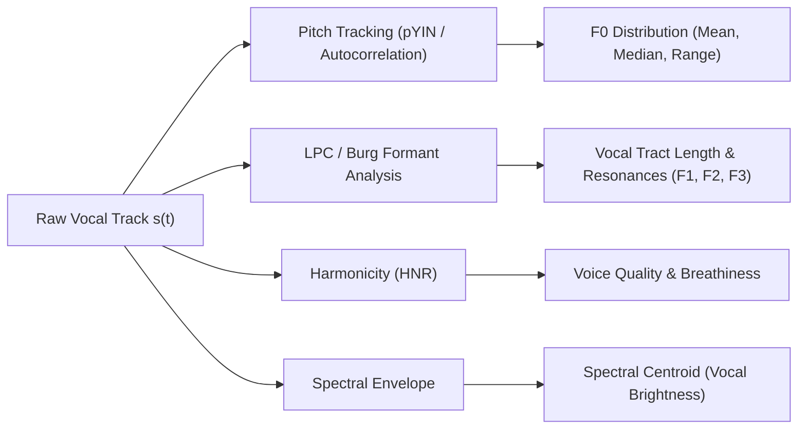
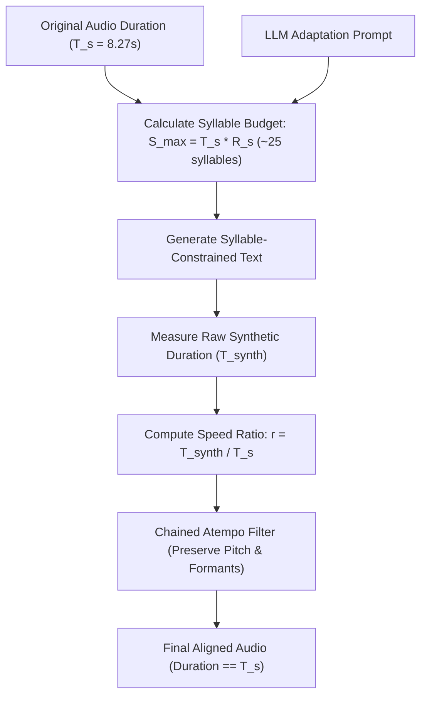
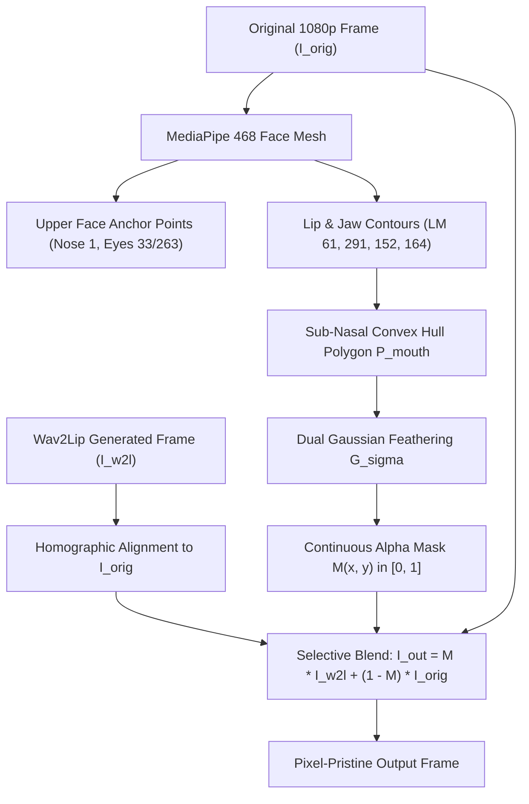
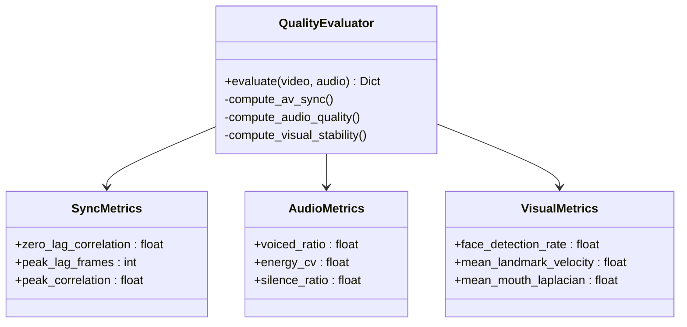

<!-- markdownlint-disable -->

# Mathematical Foundations & Implementation Details of Nativox

> **Creator & Lead Architect**: Babin Bid  
> This document details the mathematical models, acoustic formulas, geometric equations, and algorithmic implementations underpinning the Nativox Speaker Performance Transfer Engine (SPTE), Neural Lip Generation, and Quality Evaluation systems.

---

## 1. Acoustic Performance Modeling & Voice Profiling

The Speaker Performance Transfer Engine models speech as an acoustic signal $s(t)$, which can be decomposed into:
$$s(t) = e(t) * h(t)$$
where $e(t)$ is the glottal source excitation signal (fundamental pitch $F_0$, vocal cord pulse dynamics) and $h(t)$ is the vocal tract filter impulse response (formants $F_1, F_2, \dots, F_n$).

### 1.1 Fundamental Frequency ($F_0$) Extraction
$F_0$ is tracked via the probabilistic YIN (pYIN) algorithm and normalized autocorrelation:
$$r_t(\tau) = \frac{\sum_{j=t}^{t+W} s(j) s(j+\tau)}{\sqrt{\sum_{j=t}^{t+W} s^2(j) \cdot \sum_{j=t}^{t+W} s^2(j+\tau)}}$$
Candidate pitch periods $\tau^*$ are chosen by finding local minima in the cumulative mean normalized difference function $d'_t(\tau)$:
$$d'_t(\tau) = \begin{cases} 
1, & \text{if } \tau = 0 \\ 
\frac{d_t(\tau)}{\frac{1}{\tau} \sum_{j=1}^\tau d_t(j)}, & \text{otherwise} 
\end{cases}$$
From the extracted contour, the speaker profile computes:
* **Median Pitch**: $\tilde{F}_0 = \text{median}(\{f_t \mid f_t > 0\})$
* **Pitch Dynamics / Dispersion**: $\sigma_{F_0} = \sqrt{\frac{1}{N} \sum_{t=1}^N (f_t - \mu_{F_0})^2}$
* **Voiced Speech Ratio**: $V_r = \frac{N_{\text{voiced}}}{N_{\text{total}}}$

### 1.2 Formant Frequency Estimation (Burg Method)
Formant resonances correspond to the poles of the all-pole linear predictive coding (LPC) filter:
$$H(z) = \frac{1}{1 - \sum_{k=1}^P a_k z^{-k}}$$
The Burg method estimates prediction coefficients $a_k$ by minimizing the sum of forward and backward squared prediction errors:
$$E_m = \sum_{n=m}^{N-1} \left( |e_{f,m}(n)|^2 + |e_{b,m}(n)|^2 \right)$$
The roots $z_i = r_i e^{j \theta_i}$ of the polynomial $A(z)$ yield the formant frequencies $F_i$ and bandwidths $B_i$:
$$F_i = \frac{f_s}{2\pi} \arctan\left(\frac{\text{Im}(z_i)}{\text{Re}(z_i)}\right), \quad B_i = -\frac{f_s}{\pi} \ln(|z_i|)$$
The formant ratio $\alpha = \frac{F_{2,\text{speaker}}}{F_{2,\text{synth}}}$ determines the vocal tract length scaling factor.

### 1.3 Harmonics-to-Noise Ratio (HNR)
HNR measures the degree of glottal periodic vibration versus aspiration noise:
$$\text{HNR} = 10 \log_{10} \left( \frac{R_x(r_{\text{max}})}{R_x(0) - R_x(r_{\text{max}})} \right) \text{ dB}$$
where $R_x(0)$ is total signal energy and $R_x(r_{\text{max}})$ is the energy of the periodic harmonic component.

---

## 2. Syllable Budgeting & Dynamic Temporal Warping

A critical challenge in cross-lingual dubbing is **isochrony mismatch**: English is stress-timed, while Hindi and Bengali are syllable-timed.

### 2.1 Syllable Budget Constraint
Let $T_s$ be the duration of the original speech interval. The maximum allowable syllable count $S_{\text{target}}$ for natural Indic speech is:
$$S_{\text{target}} \approx T_s \times R_s$$
where $R_s \in [2.8, 3.4]$ syllables per second represents standard conversational speaking rate in Hindi and Bengali.

### 2.2 Chained Pitch-Invariant Tempo Scaling
To adjust tempo without altering fundamental pitch ($F_0$), Nativox uses chained phase vocoders via FFmpeg `atempo`:
$$\text{Ratio } r = \frac{T_{\text{synth}}}{T_s}$$
Because each individual `atempo` filter operates within $r_i \in [0.5, 2.0]$, arbitrary scaling ratios are decomposed:
$$r = \prod_{i=1}^K r_i, \quad 0.5 \le r_i \le 2.0$$
The phase vocoder shifts the time axis by applying an STFT, modifying frame hop sizes, and unwrapping phase angles:
$$\phi(t + \Delta t) = \phi(t) + \omega_0 \Delta t$$

---

## 3. Dense Landmark Geometry & Selective Mask Compositing

Standard lip-sync generators distort the entire lower face and introduce boundary artifacts. Nativox uses a **sub-nasal convex polygon mask** with temporal distance weighting.

### 3.1 Sub-Nasal Boundary Definition
To ensure eyes, cheeks, forehead, and glasses remain untouched, the compositing boundary is bounded strictly below the sub-nasal base point:
$$y_{\text{cutoff}} = y_{\text{landmark } 164} + \epsilon_{\text{nasal}}$$
The mouth contour is defined by the convex hull of the landmark set $\mathcal{L}_{\text{mouth}}$:
$$\mathcal{L}_{\text{mouth}} = \{61, 291, 13, 14, 152, 164, 172, 397\} \subset \mathbb{R}^2$$

### 3.2 Temporal Alpha Feathering
The binary polygon $P(x, y)$ is smoothed using a Gaussian kernel $G_\sigma$ to prevent hard edge seams:
$$M(x, y) = P(x, y) * G_\sigma(x, y) = \iint P(u, v) \frac{1}{2\pi \sigma^2} e^{-\frac{(x-u)^2 + (y-v)^2}{2\sigma^2}} \, du \, dv$$
The final composite frame $I_{\text{out}}(x, y)$ is evaluated as:
$$I_{\text{out}}(x, y) = M(x, y) \cdot I_{\text{gen}}(x, y) + (1 - M(x, y)) \cdot I_{\text{orig}}(x, y)$$

---

## 4. Objective Quality Evaluation Metrics

The `QualityEvaluator` computes quantitative validation metrics across four independent dimensions:

### 4.1 Audio-Visual Sync: MAR–RMS Cross-Correlation
* **Mouth Aspect Ratio (MAR)**:
  $$\text{MAR}(t) = \frac{\|\mathbf{p}_{13}(t) - \mathbf{p}_{14}(t)\|_2}{\|\mathbf{p}_{61}(t) - \mathbf{p}_{291}(t)\|_2}$$
* **Audio Root-Mean-Square Energy (RMS)**:
  $$\text{RMS}(t) = \sqrt{\frac{1}{H} \sum_{n=t \cdot H}^{(t+1) \cdot H} s^2(n)}$$
* **Normalized Cross-Correlation with Lag $\tau$**:
  $$R_{\text{MAR, RMS}}(\tau) = \frac{\sum_{t} (\text{MAR}(t) - \mu_{\text{MAR}})(\text{RMS}(t+\tau) - \mu_{\text{RMS}})}{\sigma_{\text{MAR}} \sigma_{\text{RMS}}}$$
* **Acceptance Criteria**: $\tau^* = \arg\max_\tau R(\tau) \in [-1, +1]$ frames.

### 4.2 Visual Stability: Mean Landmark Velocity
Measures frame-to-frame landmark jitter:
$$V_{\text{LM}} = \frac{1}{T-1} \sum_{t=1}^{T-1} \frac{1}{|\mathcal{L}|} \sum_{i \in \mathcal{L}} \|\mathbf{p}_i(t+1) - \mathbf{p}_i(t)\|_2$$
A lower value ($< 2.5$ pixels/frame) confirms stable, flicker-free face tracking.

### 4.3 Mouth Blur & Sharpness: Laplacian Variance
Evaluates high-frequency spatial edge clarity inside the mouth ROI $\Omega$:
$$\text{Sharpness} = \text{Var}\left( \nabla^2 I_\Omega \right) = \text{Var}\left( \frac{\partial^2 I}{\partial x^2} + \frac{\partial^2 I}{\partial y^2} \right)$$
Higher values ($> 20.0$) confirm sharp lip vermilion and clear teeth boundaries.
